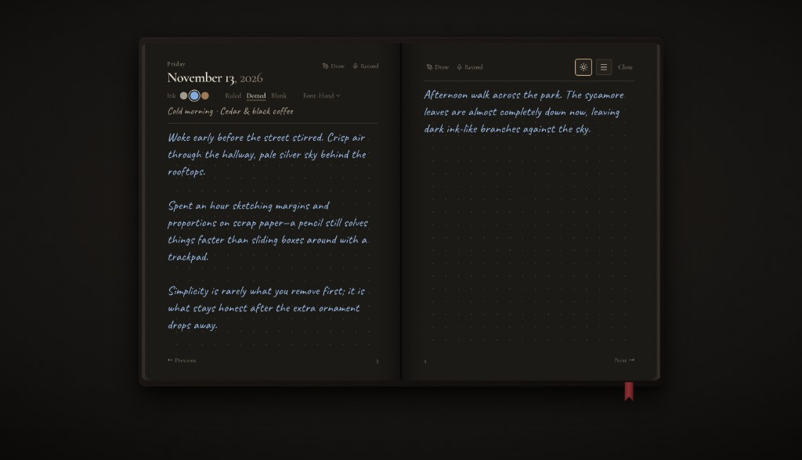
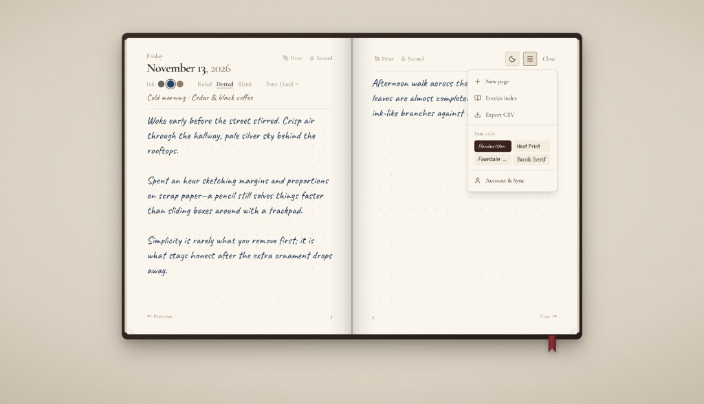
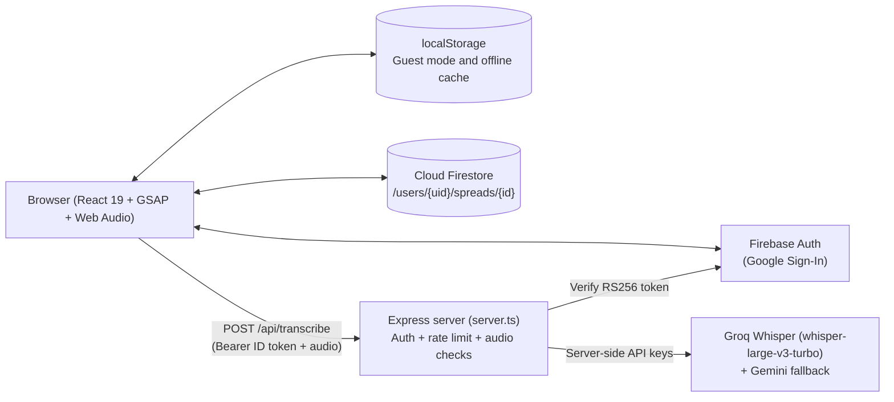
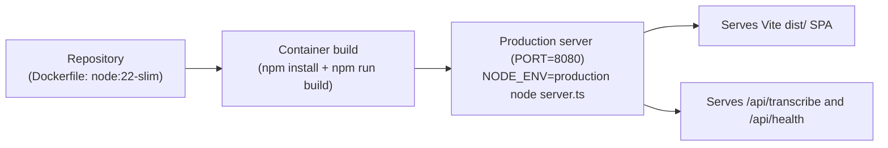

<div align="center">


# Folio

**A quiet place to put your thoughts.**

A digital journal that feels like opening a book. Open the cover, turn pages with a natural curl, write or draw with a stylus, dictate your thoughts, and keep everything in sync across devices.

[**Live app**](https://folio-journal-book.ai.studio/) · [Features](#features) · [Architecture](#architecture) · [Get started](#get-started) · [Known limitations](#known-limitations)

<!-- Replace with a 10-second screen recording of the cover opening and a page curl -->
<!--  -->

</div>

---

## Screenshots

<div align="center">

| **Closed book** | **Dark mode** | **Settings & fonts** |
|:---:|:---:|:---:|
|  |  |  |

</div>

> Open the [live app](https://folio-journal-book.ai.studio/) to try the 3D cover, the page curl, and the bookmark ribbon.

---

## Features

### A book you can feel
- **3D hardbound cover** that opens and closes with GSAP choreography, cast shadows, and a desk surface.
- **Drag-to-fold page curl** with spine-clamped geometry, fold shadows, a curled flap, and flick or return animations.
- **Bookmark ribbon** with progressive pull resistance, lateral sway, and a damped spring bounce when released.
- **Responsive spreads:** a two-page layout on desktop and a single-page portrait layout on mobile, with a landscape guidance prompt.

### Writing and drawing
- **Customizable paper:** ruled, dotted, or blank.
- **Ink tones:** `charcoal`, `midnight`, and `sepia`, plus a font picker.
- **Text that flows across pages:** when a page fills up, writing continues onto the next page or a continuation spread.
- **Stylus ink canvas:** pressure-sensitive pen, fountain pen, highlighter, and eraser (stroke or barrel), with undo and redo.
- **Input handling:** Apple Pencil, touch, and mouse are told apart, with palm rejection so stylus strokes never trigger page curls.

### Voice dictation
- **Speech-to-text** with Groq Whisper (`whisper-large-v3-turbo`) and a Gemini fallback.
- **Live level meter** while recording.
- **Client-side checks:** silence detection and a quiet-mic boost that resamples to mono WAV.

### Your entries, your way
- **Guest mode:** entries are saved in `localStorage` out of the box.
- **Optional Google Sign-In and Firestore sync:** guest entries merge into your cloud journal when you sign in.
- **Entries index:** sort, filter by month, preset ranges, or custom dates, and jump to any spread.
- **CSV export:** with formula-injection-safe escaping, for backups.
- **Light and dark themes.**

---

## Architecture



### Code layering

The code is organized so that UI stays simple and logic stays testable:

```
types/       Pure TypeScript types, one file per feature
constants/   Config values and tuning numbers, one file per feature
utils/       Pure functions with no React imports (geometry, ink math, dates, CSV)
hooks/       State, effects, animation loops, and sync (useXxx)
components/  Presentational JSX, kept small, props and refs only
```

High-frequency interactions (page curl, bookmark ribbon, audio level meter) update through refs, not React state, so they don't re-render the whole book at 60fps.

### Voice transcription protection

`POST /api/transcribe` is protected on the server before any speech model is called:

- **Authentication:** requires a verified Firebase Auth ID token (`Authorization: Bearer <token>`), validated against Google's x509 certificates.
- **Rate limiting:** a sliding window per IP (`15 req/min`) and per user (`8 req/min`), returning `429` with `Retry-After`.
- **Daily quotas:** per user (`60 requests/day`, `900 s` of audio/day) and a global circuit breaker (`1000 requests/day`).
- **Payload and duration validation:** `9 MB` JSON cap, `6 MB` WAV / `3 MB` compressed audio cap, container magic-byte inspection, and a server-side WAV header duration check (`0.2 s` to `185 s`).
- **Audit logging:** structured JSON logs (uid prefix, hashed IP, duration, bytes, latency, outcome) that never include audio or transcript text.

---

## Database schema

When signed in, entries are stored in Cloud Firestore with owner-only access and field validation enforced in `firestore.rules` and `firebase-blueprint.json`.

### `/users/{userId}` (`UserProfile`)

| Field | Type | Constraints |
|---|---|---|
| `uid` | `string` | Matches `request.auth.uid` and path `{userId}` |
| `displayName` | `string` | Max `120` chars |
| `email` | `string` | Verified email, `3` to `320` chars |
| `updatedAt` | `timestamp` | Must equal `request.time` |

### `/users/{userId}/spreads/{spreadId}` (`JournalSpread`)

| Field | Type | Constraints |
|---|---|---|
| `id` | `string` | `^[a-zA-Z0-9_-]+$`, matches `{spreadId}` |
| `userId` | `string` | Immutable owner UID (`== request.auth.uid`) |
| `date` | `string` | `YYYY-MM-DD` |
| `contextNote` | `string` | Max `240` chars |
| `leftBody` | `string` | Max `20,000` chars |
| `rightBody` | `string` | Max `20,000` chars |
| `inkColor` | `enum` | `charcoal` \| `midnight` \| `sepia` |
| `paperStyle` | `enum` | `ruled` \| `dotted` \| `blank` |
| `clientUpdatedAt` | `number` | Client timestamp in ms, used for merge ordering |
| `updatedAt` | `timestamp` | Must equal `request.time` |

Guest mode stores an array of `JournalSpread` objects in `localStorage` and merges them into Firestore on sign-in.

---

## Get started

### Requirements

- **Node.js 22 or newer** (22.18+ for native TypeScript execution in `npm start`)
- **npm**
- A **Groq API key** (free tier at [console.groq.com](https://console.groq.com)) and/or a **Gemini API key** for voice dictation

### Run locally

```bash
git clone https://github.com/ArnavPoswal15/Folio.git
cd Folio
npm install
cp .env.example .env
```

Add your keys to `.env`:

```bash
GROQ_API_KEY="your_groq_api_key"
GEMINI_API_KEY="your_gemini_api_key"
```

Optional rate-limit and quota overrides are documented in `.env.example`:
`TRANSCRIBE_IP_RATE_LIMIT_PER_MIN`, `TRANSCRIBE_USER_RATE_LIMIT_PER_MIN`, `TRANSCRIBE_USER_DAILY_REQUESTS`, `TRANSCRIBE_USER_DAILY_AUDIO_SECONDS`, `TRANSCRIBE_GLOBAL_DAILY_REQUESTS`, `TRANSCRIBE_MAX_AUDIO_SECONDS`.

Start the dev server:

```bash
npm run dev
```

Open [http://localhost:3000](http://localhost:3000).

### Use your own Firebase project

1. Update `firebase-applet-config.json` with your project's web config.
2. Deploy `firestore.rules`.
3. Add your host domain under **Firebase Console, Authentication, Settings, Authorized domains**.

### Commands

| Command | Description |
|---|---|
| `npm run dev` | Start the Express and Vite dev server on port `3000` |
| `npm run lint` | Run Oxlint and TypeScript type checking |
| `npm run typecheck` | Run `tsc --noEmit` |
| `npm run build` | Build the production client bundle into `dist/` |
| `NODE_ENV=production npm start` | Start the production server (`node server.ts`) |

---

## Deployment



The `Dockerfile` builds static assets with `npm run build` and runs `node server.ts` on port `8080`, which suits Google Cloud Run.

---

## Known limitations

- **Voice dictation requires sign-in.** Guests can write, draw, customize pages, and export CSV locally. Dictation needs Google Sign-In so `/api/transcribe` can enforce per-user quotas.
- **In-memory rate limiting.** Limits and daily quotas live in process memory per instance. Multiple instances or cold restarts reset the counters unless you back them with Redis or Firestore.
- **Single-owner privacy.** Firestore rules restrict all reads and writes to the authenticated owner. Shared or collaborative journals are not supported.
- **Browser audio support.** Recording relies on `MediaRecorder` and the Web Audio API (`getUserMedia`), which need HTTPS (or `localhost`) and microphone permission.

---

## Roadmap

- [ ] Add demo GIF
- [x] Add screenshots to README
- [x] Split large components into small presentational components, hooks, and utils
- [ ] Move 60fps interactions (curl, audio meter) fully to refs
- [ ] Unit tests for pure utils (curl geometry, ink math, CSV escaping, date helpers, overflow split)
- [ ] GitHub Actions workflow for lint, typecheck, and tests
- [ ] Persistent rate limiting for multi-instance deployments

---

## Built with

React · TypeScript · Vite · Tailwind CSS · GSAP · Express · Firebase · Google GenAI · Groq

---

## Contributing

Issues and pull requests are welcome. Before opening a PR, run:

```bash
npm run lint
npm run typecheck
```

When adding code, please follow the layering above: types in `types/`, tuning numbers in `constants/`, pure logic in `utils/`, stateful logic in `hooks/`, and keep components presentational with JSDoc on exported functions.

---

## License

Add a `LICENSE` file (for example MIT) and state it here.

---

<div align="center">

Generated from [google-gemini/aistudio-repository-template](https://github.com/google-gemini/aistudio-repository-template)

</div>