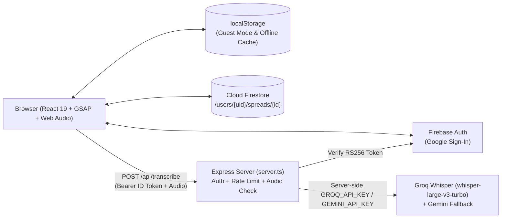
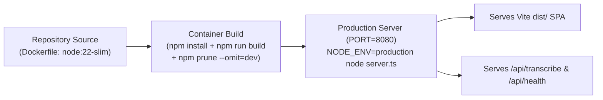

<div align="center">


# Folio

**A quiet place to put your thoughts.**

</div>

Folio is a digital journal designed to feel like opening a book. Write on customizable paper, turn pages with a natural curl, and keep your entries on your device or sync them across devices.

**Live app:** [folio-journal on Google Cloud](https://folio-journal-book.ai.studio/) · **Latest release:** [`v1.1.0`](./CHANGELOG.md)

## Features

- **A book-like writing experience** with 3D cover opening, drag-to-fold GSAP page curls, and responsive desktop/mobile spreads.
- **Light & dark mode** — switches between a warm ivory-paper studio desk and a charcoal cotton-paper night desk with adaptive high-contrast inks, system preference detection, and zero-flash persistence (`folio-theme`).
- **Your page, your way** with ruled, dotted, or blank paper and three ink colors (`charcoal`, `midnight`, `sepia`).
- **Voice dictation** powered by Groq Whisper (`whisper-large-v3-turbo`) with Gemini fallback, client-side silence check, and quiet-mic WAV boost.
- **Guest mode & clean cloud sync** — guest entries persist locally in `localStorage` and merge on sign-in, while signed-in accounts start directly with a clean dated spread synced via Google Sign-In and Cloud Firestore.
- **Entries index & CSV export** with date sorting, month and custom range filtering, local calendar dates, and spreadsheet formula-injection protection.

> **Preview & Screenshots:** Open the [live app](https://folio-journal-book.ai.studio/) to try the interactive book cover and page curl. *(Add captured screenshots or a page-turn demo GIF under `docs/` when publishing showcase media.)*

---

## Architecture



### Security & Voice Transcription Protection

`POST /api/transcribe` and the Express server enforce layered protections before invoking Groq Whisper or Gemini:

- **Authentication:** Requires a verified Firebase Auth ID token (`Authorization: Bearer <token>`), validated against Google's x509 certificates (fetched with an `8s` timeout).
- **Rate limiting:** Sliding-window per-IP (`15 req/min`) and per-user (`8 req/min`) limits returning `429` + `Retry-After` headers.
- **Daily quotas:** Per-user (`60 requests/day`, `900s` total audio/day) and global daily circuit breaker (`1000 requests/day`).
- **Payload & duration validation:** `9 MB` JSON body cap (`100 KB` on other routes), `6 MB` WAV / `3 MB` compressed audio cap, container magic-byte inspection, and server-side WAV header duration check (`0.2s`–`185s`).
- **HTTP hardening & audit logging:** Disables `x-powered-by`, sets `X-Content-Type-Options: nosniff` and `Referrer-Policy: strict-origin-when-cross-origin`, and writes structured JSON audit logs (`uid` prefix, hashed IP, duration, bytes, latency, outcome) without logging audio or transcript text.

---

## Database Schema

When signed in with Google, entries are stored in Cloud Firestore (with strict owner-only access and field validation enforced in `firestore.rules` and `firebase-blueprint.json`).

### `/users/{userId}` (`UserProfile`)

| Field | Type | Constraints |
| --- | --- | --- |
| `uid` | `string` | Matches `request.auth.uid` and path `{userId}` |
| `displayName` | `string` | Max `120` chars |
| `email` | `string` | Verified email, `3`–`320` chars |
| `updatedAt` | `timestamp` | Enforced equal to `request.time` |

### `/users/{userId}/spreads/{spreadId}` (`JournalSpread`)

| Field | Type | Constraints |
| --- | --- | --- |
| `id` | `string` | `^[a-zA-Z0-9_-]+$`, matches `{spreadId}` |
| `userId` | `string` | Immutable owner UID (`== request.auth.uid`) |
| `date` | `string` | `YYYY-MM-DD` |
| `contextNote` | `string` | Max `240` chars |
| `leftBody` | `string` | Max `20,000` chars |
| `rightBody` | `string` | Max `20,000` chars |
| `inkColor` | `enum` | `charcoal` \| `midnight` \| `sepia` |
| `paperStyle` | `enum` | `ruled` \| `dotted` \| `blank` |
| `clientUpdatedAt` | `number` | Client ms timestamp for merge ordering |
| `updatedAt` | `timestamp` | Enforced equal to `request.time` |

Guest mode stores an array of `JournalSpread` objects locally in browser `localStorage` and merges/syncs cleanly upon signing in.

---

## Deployment Architecture



- **Container:** `Dockerfile` uses `node:22-slim`, builds static assets with `npm run build`, prunes `devDependencies` with `npm prune --omit=dev`, and runs `node server.ts` on port `8080`.

---

## Get started

### Requirements

- **Node.js 22 or newer** (Node `22.18+` for native TypeScript execution in `npm start`)
- **npm**
- A **Groq API key** (`GROQ_API_KEY`, free tier at [console.groq.com](https://console.groq.com)) and/or a **Gemini API key** (`GEMINI_API_KEY`) for voice dictation

### Run locally

```bash
git clone https://github.com/ArnavPoswal15/FOLIO.git
cd FOLIO
npm install
cp .env.example .env
```

Add your API key(s) to `.env`:

```env
GROQ_API_KEY="your_groq_api_key"
GEMINI_API_KEY="your_gemini_api_key"
```

Optional rate-limit and quota overrides (`TRANSCRIBE_IP_RATE_LIMIT_PER_MIN`, `TRANSCRIBE_USER_RATE_LIMIT_PER_MIN`, `TRANSCRIBE_USER_DAILY_REQUESTS`, `TRANSCRIBE_USER_DAILY_AUDIO_SECONDS`, `TRANSCRIBE_GLOBAL_DAILY_REQUESTS`, `TRANSCRIBE_MAX_AUDIO_SECONDS`) are documented in `.env.example`.

Then start the development server:

```bash
npm run dev
```

Open [http://localhost:3000](http://localhost:3000).

To use Google Sign-In and Firestore sync on your own Firebase project, update `firebase-applet-config.json`, deploy `firestore.rules`, and add your host domain under **Firebase Console → Authentication → Settings → Authorized domains**.

## Commands

| Command | Description |
| --- | --- |
| `npm run dev` | Start Express + Vite dev server on port `3000` |
| `npm run lint` | Run Oxlint and TypeScript type checking |
| `npm run typecheck` | Run TypeScript checking (`tsc --noEmit`) |
| `npm run build` | Build production client bundle into `dist/` |
| `NODE_ENV=production npm start` | Start production server (`node server.ts`) |

## Known Limitations

- **Voice dictation requires sign-in:** Guests can write, customize pages, and export CSV locally, while voice dictation requires Google Sign-In so `/api/transcribe` can enforce per-user quotas.
- **In-memory rate limiting:** Rate limits and daily quotas are tracked in process memory per Cloud Run instance; multi-instance deployments or cold restarts reset counters unless backed by Redis/Firestore.
- **Single-owner privacy:** Firestore rules restrict all reads and writes strictly to the authenticated owner (`request.auth.uid`); shared/collaborative journals are not supported.
- **Browser audio support:** Voice recording relies on browser `MediaRecorder` and Web Audio API (`getUserMedia`), which require HTTPS (or `localhost`) and microphone permission.

## Built with

React · TypeScript · Vite · Tailwind CSS · GSAP · Express · Firebase · Groq Whisper · Google GenAI
